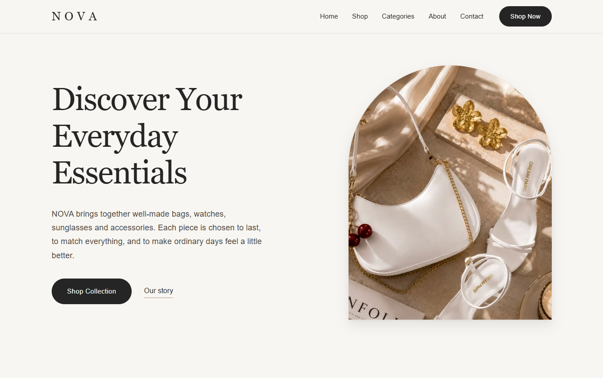
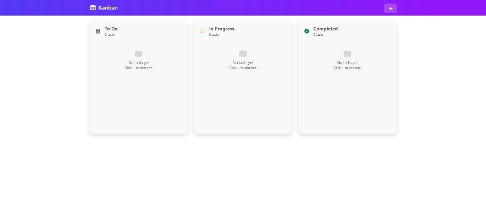
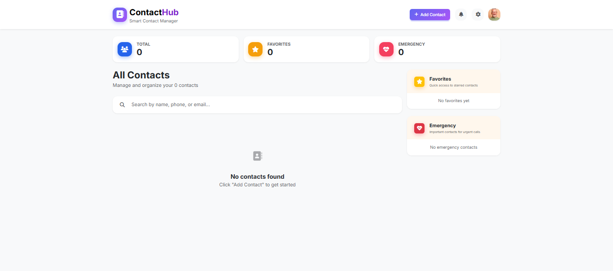
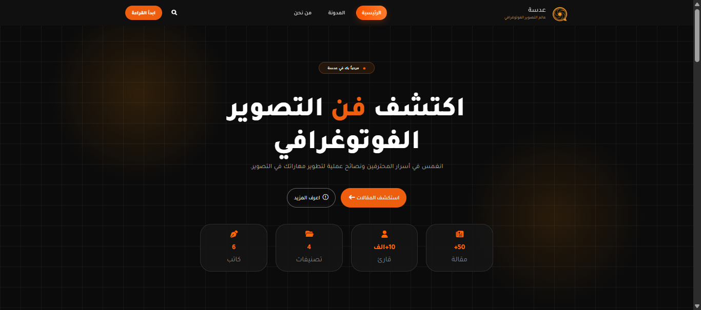

# Portfolio Website

## Project Overview

A personal portfolio website that presents Hana Elnegery's background, skills, projects, and professional experience as a front-end developer.

## Features

- Home
- About
- Skills
- Projects
- Achievements
- Contact

## Technologies Used

- HTML5
- CSS3

## Design

The website follows a minimal light design with a blue color theme. Its clean layout and responsive design provide a consistent experience across desktop, tablet, and mobile screens.

  
  
  

  

